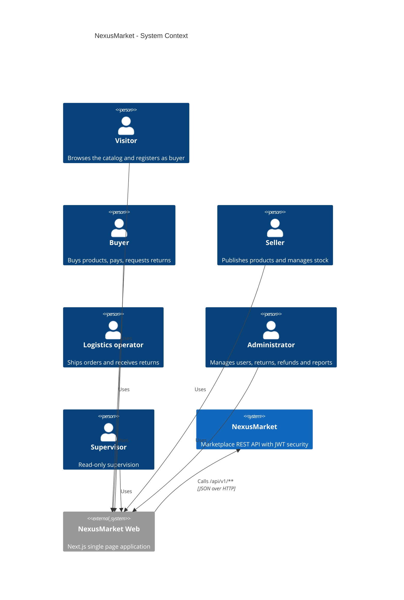

# C4 Level 1 - System Context

NexusMarket is a marketplace where sellers publish products, buyers purchase them and the marketplace operation (logistics, administration, supervision) keeps stock, shipments, returns and refunds under control.

## Actors

| Actor | Role in the system | Spring authority |
|---|---|---|
| Visitor | Browses the published catalog and registers as a buyer | none |
| Buyer | Manages cart, orders, payment, returns and addresses | `ROLE_BUYER` |
| Seller | Manages own products, variants and inventory | `ROLE_SELLER` |
| Logistics operator | Prepares, packs, dispatches and delivers shipments; receives returns; adjusts inventory | `ROLE_LOGISTICS_OPERATOR` |
| Administrator | Registers sellers and internal users, changes statuses, approves or rejects returns, processes refunds, reads every report | `ROLE_ADMINISTRATOR` |
| Supervisor | Read-only access to consultations and reports | `ROLE_SUPERVISOR` |

Business rule RG-02: every user has exactly one role.

## External systems

| System | Status |
|---|---|
| Payment gateway | Not integrated. Payment approval is received as a boolean (`paymentApproved`) in `POST /buyer/orders/{orderId}/pay` |
| Carriers | Not integrated. Carrier name and tracking number are recorded by the logistics operator |
| MongoDB audit | Pending a decision of the professor (not part of the current build) |

