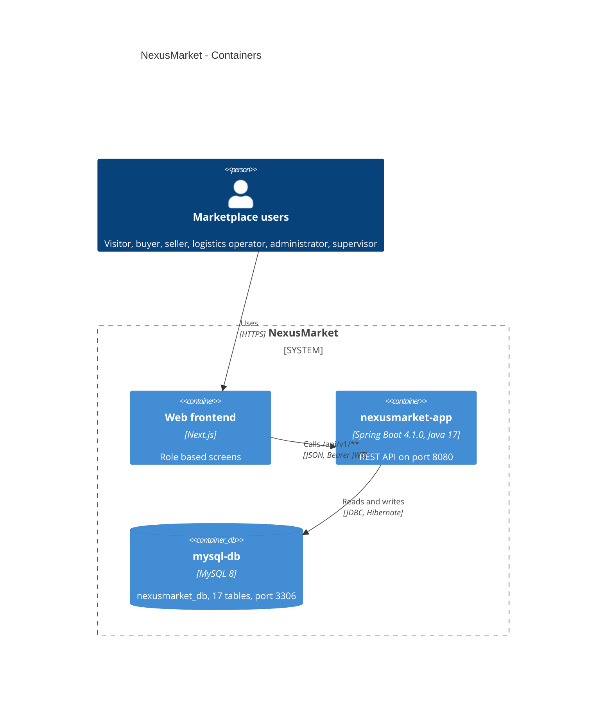

# C4 Level 2 - Containers

## Containers

| Container | Technology | Responsibility |
|---|---|---|
| Web frontend | Next.js (to be built) | Role based screens; stores the JWT and sends it in every call |
| `nexusmarket-app` | Spring Boot 4.1.0, Java 17, Maven | REST API on port 8080: security, use cases, domain and persistence |
| `mysql-db` | MySQL 8 | Schema `nexusmarket_db` with 17 tables, port 3306 |

## Docker network

`docker-compose.yml` starts two services on the same network:

| Service | Image | Port | Notes |
|---|---|---|---|
| `mysql-db` | MySQL 8 | 3306 | Health check; the application waits until it is healthy |
| `nexusmarket-app` | Built from `nexusmarket/Dockerfile` (Maven + Temurin 17) | 8080 | Connects to `mysql-db`; a `maven_cache` volume speeds up rebuilds |

Start everything with `docker compose up -d --build`; stop with `docker compose down` (add `-v` to also erase the database).

## Environments

| Environment | Database | Configuration |
|---|---|---|
| Local / Docker | MySQL `nexusmarket_db` | `src/main/resources/application.properties` (`ddl-auto=update`) |
| Unit and integration tests | H2 in memory (MySQL mode, `create-drop`) | `src/test/resources/application.properties` |

JWT settings come from `jwt.secret` and `jwt.expiration-ms`; the allowed frontend origins from `FRONTEND_ORIGIN`.