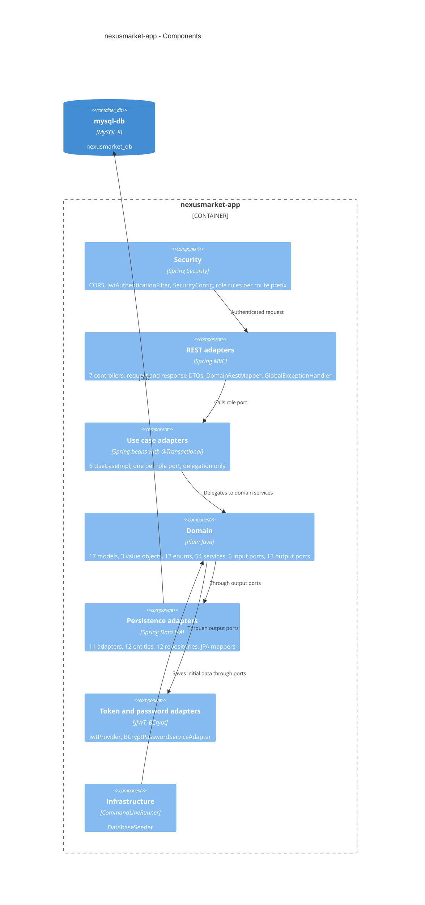
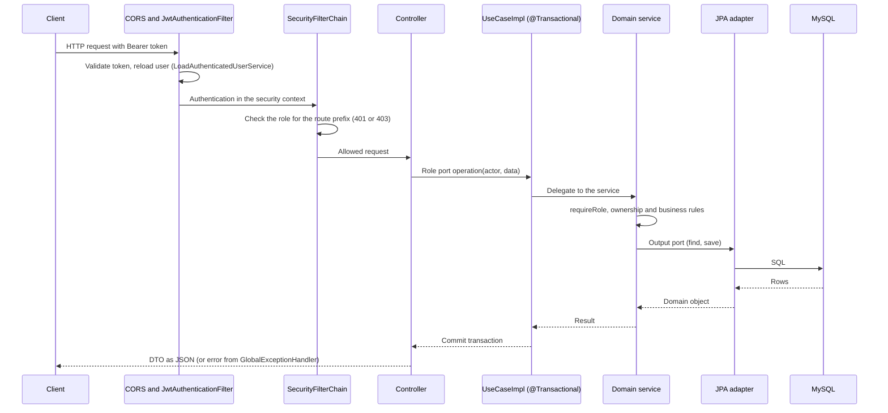

# C4 Level 3 - Components of `nexusmarket-app`

## Request lifecycle

## Two authorization layers

1. **Route level** (`SecurityConfig`): the prefix `/api/v1/<role>/**` requires the matching `ROLE_*`; failures answer 401 or 403 as JSON.
2. **Domain level**: every service calls `ValidateRoleAuthorizationService.requireRole` and, when needed, `ValidateOwnershipService.requireOwner`. A violation raises `UnauthorizedOperationException` (403).