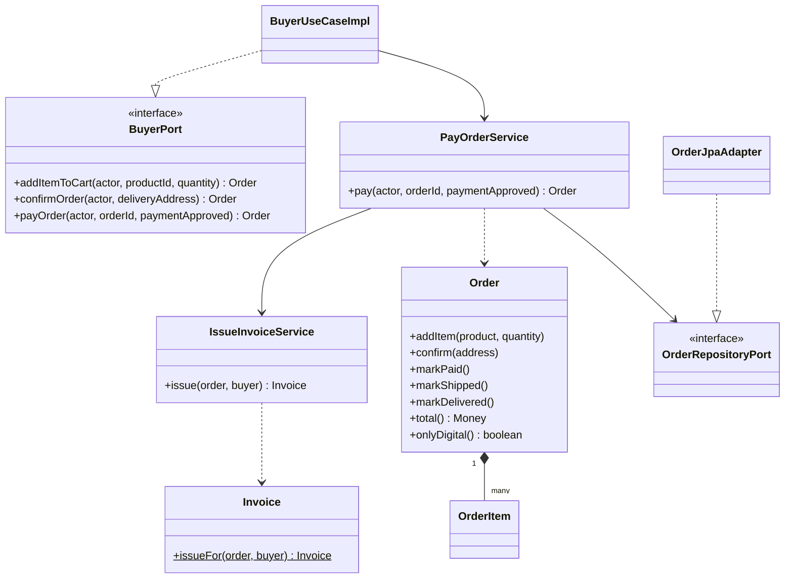
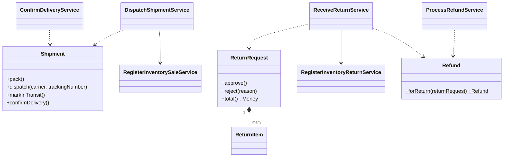
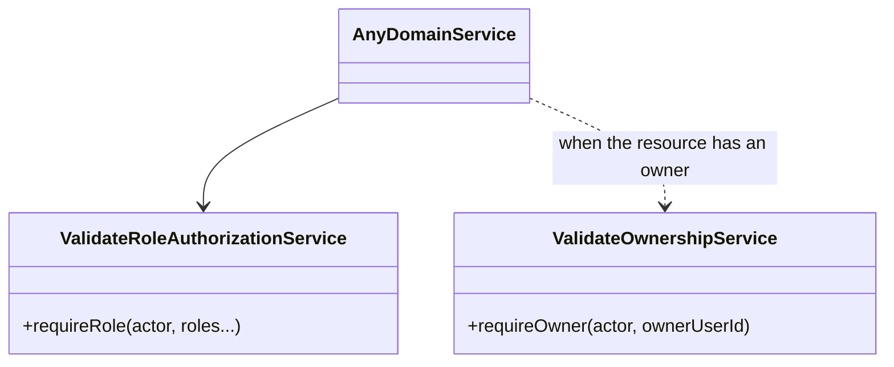

# C4 Level 4 - Code

Only the classes that take part in the main flows are drawn.

## Purchase and billing

## Shipping, returns and refunds

## Authorization collaborators

Complete class tables are generated in `SDD/domain/Domain Model.md`, `SDD/domain/Domain Value Objects.md` and `SDD/domain/services/`.