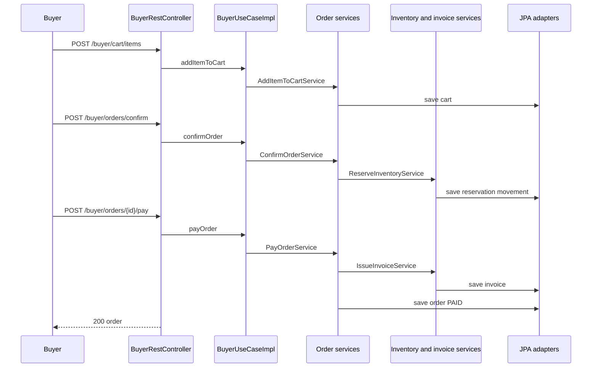
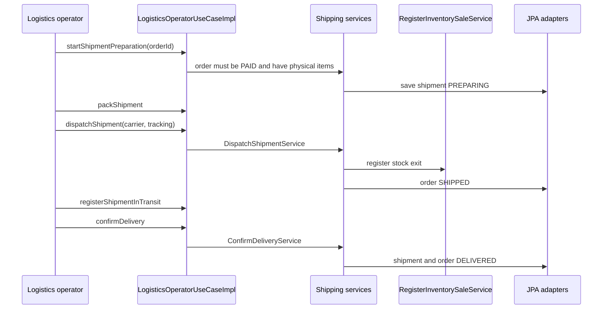
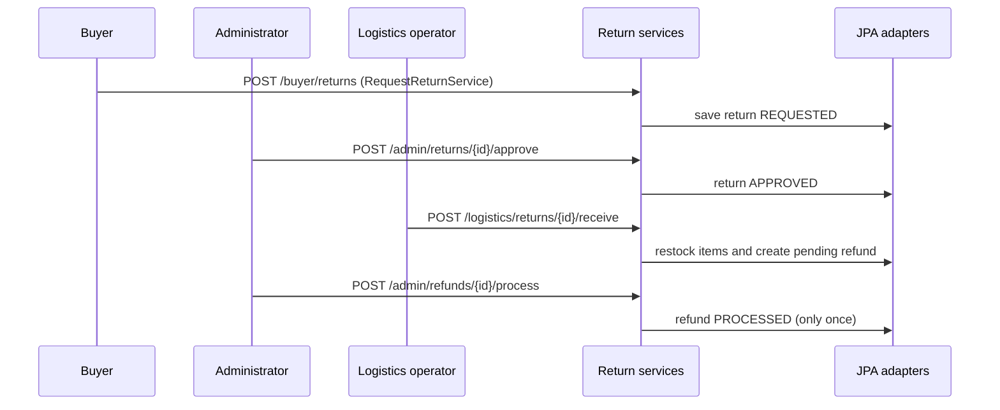

# Endpoint Flows

Matrix verified against `adapters/rest/controllers/*.java` (77 endpoints). The complete list with request bodies and status codes is generated in `SDD/adapters/Api-rest-endpoints.md`. Paths are relative to `/api/v1`.

## 1. Public access - `AuthRestController`, `PublicRestController`

| Verb | Path | Service | Notes |
|---|---|---|---|
| POST | `/auth/login` | `LoginService` | Returns a signed JWT; 401 on wrong credentials |
| POST | `/auth/register/buyer` | `RegisterBuyerService` | 201; 409 if the e-mail or document already exists |
| GET | `/public/products` | `ConsultPublishedProductsService` | Only published products |

## 2. Buyer - `BuyerRestController` (`BuyerPort`, `ROLE_BUYER`)

| Verb | Path | Service | Notes |
|---|---|---|---|
| POST | `/buyer/addresses` | `AddBuyerAddressService` | 201 |
| POST | `/buyer/cart/items` | `AddItemToCartService` | 201; creates the cart if needed |
| DELETE | `/buyer/cart/items/{productId}` | `RemoveItemFromCartService` | |
| POST | `/buyer/orders/confirm` | `ConfirmOrderService` | The address must be a registered address; reserves stock |
| POST | `/buyer/orders/{orderId}/pay` | `PayOrderService` | Issues the invoice; digital products are delivered at once |
| GET | `/buyer/orders` | `ConsultMyOrdersService` | |
| GET | `/buyer/orders/{orderId}/invoice` | `ConsultInvoiceService` | |
| GET | `/buyer/orders/{orderId}/shipment` | `ConsultShipmentService` | |
| POST | `/buyer/returns` | `RequestReturnService` | 201 |
| GET | `/buyer/returns` | `ConsultMyReturnsService` | |
| PUT | `/buyer/password` | `ChangeUserPasswordService` | 204 |

## 3. Seller - `SellerRestController` (`SellerPort`, `ROLE_SELLER`)

| Verb | Path | Service |
|---|---|---|
| POST | `/seller/products` | `RegisterProductService` |
| POST | `/seller/products/{id}/publish` | `PublishProductService` |
| POST | `/seller/products/{id}/variants` | `AddProductVariantService` |
| POST | `/seller/products/{id}/suspend` | `SuspendProductService` |
| POST | `/seller/products/{id}/discontinue` | `DiscontinueProductService` |
| POST | `/seller/inventory/entries` | `RegisterInventoryEntryService` |
| PUT | `/seller/inventory/adjustment` | `AdjustInventoryService` |
| PUT | `/seller/inventory/status` | `ChangeInventoryStatusService` |
| GET | `/seller/inventory/product/{productId}` | `ConsultInventoryService` |
| GET | `/seller/warehouses` | `ConsultWarehousesService` |
| PUT | `/seller/password` | `ChangeUserPasswordService` |

A seller can only operate on its own products and warehouses (`OwnedProductLoader`, `InventoryOperationGuard`).

## 4. Logistics operator - `LogisticsRestController` (`LogisticsOperatorPort`, `ROLE_LOGISTICS_OPERATOR`)

| Verb | Path | Service |
|---|---|---|
| POST | `/logistics/orders/{orderId}/shipment/prepare` | `StartShipmentPreparationService` |
| POST | `/logistics/shipments/{id}/pack` | `PackShipmentService` |
| POST | `/logistics/shipments/{id}/dispatch` | `DispatchShipmentService` |
| POST | `/logistics/shipments/{id}/in-transit` | `RegisterShipmentInTransitService` |
| POST | `/logistics/shipments/{id}/deliver` | `ConfirmDeliveryService` |
| POST | `/logistics/returns/{id}/receive` | `ReceiveReturnService` |
| POST, PUT, GET | `/logistics/inventory/...` (entries, adjustment, status, product, movements) | inventory services |
| GET | `/logistics/warehouses`, `/orders`, `/shipments`, `/orders/{id}/shipment`, `/returns` | consult services |
| PUT | `/logistics/password` | `ChangeUserPasswordService` |

## 5. Administrator - `AdminRestController` (`AdministratorPort`, `ROLE_ADMINISTRATOR`)

| Verb | Path | Service |
|---|---|---|
| POST | `/admin/sellers` | `RegisterSellerService` |
| POST | `/admin/users` | `RegisterInternalUserService` |
| PUT | `/admin/users/{id}/status` | `ChangeUserStatusService` |
| PUT | `/admin/buyers/{id}/commercial-status` | `ChangeBuyerCommercialStatusService` |
| POST | `/admin/warehouses` | `CreateWarehouseService` |
| PUT | `/admin/warehouses/{id}/status` | `ChangeWarehouseStatusService` |
| POST | `/admin/returns/{id}/approve` | `ApproveReturnService` |
| POST | `/admin/returns/{id}/reject` | `RejectReturnService` |
| POST | `/admin/refunds/{id}/process` | `ProcessRefundService` |
| GET | `/admin/users`, `/warehouses`, `/orders`, `/invoices`, `/shipments`, `/returns`, `/refunds` | consult services |
| GET | `/admin/inventory/product/{id}`, `/inventory/movements`, `/orders/{id}/invoice`, `/orders/{id}/shipment` | consult services |
| GET | `/admin/reports/sales` | `GenerateSalesReportService` |
| PUT | `/admin/password` | `ChangeUserPasswordService` |

## 6. Supervisor - `SupervisorRestController` (`SupervisorPort`, `ROLE_SUPERVISOR`)

13 read-only endpoints: the same consultations and the sales report of the administrator (`GET /supervisor/users`, `/warehouses`, `/inventory/product/{id}`, `/inventory/movements`, `/orders`, `/invoices`, `/orders/{id}/invoice`, `/shipments`, `/orders/{id}/shipment`, `/returns`, `/refunds`, `/reports/sales`) plus `PUT /supervisor/password`.

## 7. Error table

| Situation | HTTP |
|---|---|
| No token, invalid token or wrong credentials | 401 |
| Role not allowed for the route or the operation | 403 |
| Entity or route not found | 404 |
| Invalid body, missing field or wrong parameter type | 400 |
| HTTP verb not supported for the route | 405 |
| Insufficient stock, invalid status transition, duplicate data, unregistered address | 409 |